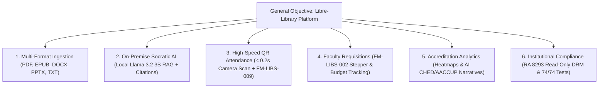

# 🎓 Libre-Library: Capstone Defense Presentation Deck
### CS 413: Software Engineering 2 • NEMSU Tandag Campus
**Format:** Official 10-Slide Academic Defense Deck & Spoken Script  
**Allocated Defense Time:** 15 Minutes Total (Presentation + System Demonstration)  
**Language:** English throughout

---

## ⏱️ Master Defense Agenda & Time Budget (15 Minutes Total)

| Section | Slides / Activity | Lead Presenter | Target Time | Cumulative |
| :--- | :--- | :---: | :---: | :---: |
| **Part I: Introduction & Chapter 1** | Slides 01 – 06 (Problem, Objectives, RAD, Scope) | Kenneth Pañares & Josepito Quezada | **4:00** | 4:00 |
| **Part II: Chapter 2 Analysis & Specs** | Slides 07 – 09 (Existing Flaws, Alternatives, FR & NFR) | Emmanuel Amista | **3:30** | 7:30 |
| **Part III: Live System Demonstration** | Slide 10 & Live Platform Walkthrough | Kieser Loren & Research Team | **6:30** | 14:00 |
| **Part IV: Panel Transition & Q&A** | Conclusion & Defense Handover | All Team Members | **1:00** | **15:00** |

---

## 👥 Group Member Role Allocation Matrix

| Group Member | Primary Defense Role | Presentation Slides | System Demonstration Responsibility |
| :--- | :--- | :---: | :--- |
| **Kenneth Pañares** | Frontend Experience & HCI Lead | **Slides 01, 02, 03** | Demonstrates Doorway QR Attendance & FM-LIBS-009 Logbook Export |
| **Josepito Quezada** | QA & Database Systems Lead | **Slides 04, 05, 06** | Demonstrates 74/74 Test Verification & Faculty Requisition FM-LIBS-002 |
| **Emmanuel Amista** | Systems Architecture & Backend Lead | **Slides 07, 08, 09** | Demonstrates Multi-Format Reader, RA 8293 Read-Only DRM & Accreditation AI |
| **Kieser Loren** | AI Engineering & Vector Pipeline Lead | **Slide 10** | Demonstrates TARS Socratic AI, Ingestion & 3D Flashcards |

---

<!-- slide -->

## Slide 1: Title, Institutional Context & Research Team

### **Libre-Library**
#### *Intelligent Digital Library Management, E-Learning Archive & AI Research Workstation*

* **Academic Institution:** North Eastern Mindanao State University (NEMSU) — Tandag Campus
* **College & Department:** College of Arts and Sciences • Department of Computer Studies
* **Curricular Course:** CS 413: Software Engineering 2 (BSCS-4C)
* **Research & Development Team:**
  * **Kenneth Pañares** — *Frontend Experience & HCI Integration Lead*
  * **Josepito Quezada** — *Quality Assurance & Database Systems Lead*
  * **Emmanuel Amista** — *Systems Architecture & Backend Lead*
  * **Kieser Loren** — *AI Engineering & Vector Pipeline Lead*
* **Project Adviser:** **Dr. Cherly B. Sardovia**

---

### 🎙️ Presenter Script (Kenneth Pañares — Target: 0:45)
> *"Good day, respected members of the panel, our distinguished faculty, and our adviser, Dr. Cherly B. Sardovia.  
> We are the BSCS-4C capstone team, and today we proudly present **Libre-Library**—an intelligent, self-hosted digital library management system, institutional e-learning archive, and offline AI research workstation engineered specifically for NEMSU Tandag Campus.  
> During this 15-minute defense, we will guide you through our Chapter 1 foundational study, our Chapter 2 system requirements analysis, and an end-to-end live demonstration of the working system. Every member of our group has a designated engineering role, and we are excited to show you how Libre-Library modernizes university library operations, enforces ISO-aligned institutional documentation, and safeguards student privacy."*

---

<!-- slide -->

## Slide 2: Chapter 1 — Background of the Study

### Institutional Context & Technological Imperative

* **The Modern Academic Library:**
  * University libraries have evolved beyond physical book warehouses into dynamic digital hubs supporting collaborative research, remote study, and accreditation readiness.
* **The Reality at NEMSU Tandag Campus:**
  * Physical foot-traffic is heavy during class transitions, but entrance tracking relies on manual paper ledgers (`FM-LIBS-009`).
  * Course textbooks, thesis manuscripts, and instructional slide decks exist across disconnected flash drives and cloud drives.
* **The Emerging AI Challenge & Data Sovereignty:**
  * Commercial generative AI services (ChatGPT, Claude) require sending student thesis drafts to foreign cloud servers.
  * This creates severe intellectual property risks and conflicts with the **Philippine Data Privacy Act of 2012 (RA 10173)**.
* **The Core Motivation:**
  * To build an on-premise, internet-resilient platform that fuses automated physical library logistics with private, locally hosted AI assistance and standardized institutional forms.

---

### 🎙️ Presenter Script (Kenneth Pañares — Target: 0:50)
> *"To provide context for our study: university libraries in regional state universities face a unique dual challenge. On one hand, physical student traffic is dense, yet daily entrance tracking still relies on manual paper ledgers. On the other hand, academic materials are fragmented across physical shelves, flash drives, and random cloud links with no central reading tracking.  
> Furthermore, with the rise of generative AI, students frequently upload unpublished research and thesis manuscripts to commercial cloud models. This compromises university intellectual property and exposes student data to third-party cloud servers outside Philippine jurisdiction under RA 10173.  
> Libre-Library was conceived to solve this exact problem: establishing a unified, self-hosted campus archive powered by 100% on-premise artificial intelligence, protected by strict copyright controls, and functioning seamlessly even during internet disruptions."*

---

<!-- slide -->

## Slide 3: Chapter 1 — Statement of the Problem

### Five Critical Operational Bottlenecks

```
┌─────────────────────────────────────────────────────────────────────────────┐
│                       CRITICAL PROBLEMS IDENTIFIED                          │
├────────────────────────────────┬────────────────────────────────────────────┤
│ 1. Entrance Logbook Bottleneck │ Manual paper logs (FM-LIBS-009) cause line │
│                                │ queues; zero automated dwell-time analytics│
├────────────────────────────────┼────────────────────────────────────────────┤
│ 2. Fragmented Learning Assets  │ PDF, EPUB, DOCX, & PPTX scattered without  │
│                                │ centralized search or reading checkpoints. │
├────────────────────────────────┼────────────────────────────────────────────┤
│ 3. Cloud AI Privacy Violations │ Third-party cloud LLMs expose student data │
│                                │ and fail completely during internet outages│
├────────────────────────────────┼────────────────────────────────────────────┤
│ 4. Opaque Book Requisitions    │ Faculty submit purchase memos (FM-LIBS-002)│
│                                │ on paper with zero status transparency.    │
├────────────────────────────────┼────────────────────────────────────────────┤
│ 5. Manual Accreditation Audits │ Library staff spend days manually auditing │
│                                │ ledgers for CHED and AACCUP visits.        │
└────────────────────────────────┴────────────────────────────────────────────┘
```

---

### 🎙️ Presenter Script (Kenneth Pañares — Target: 0:50)
> *"Our investigation at NEMSU Tandag Campus uncovered five core operational bottlenecks.  
> First, doorway congestion: students crowd library entrances signing paper logbooks, resulting in lost records and zero dwell-time tracking.  
> Second, learning material fragmentation: students lose track of reading progress across disparate formats like PDFs, slides, and Word documents.  
> Third, privacy and reliability risks: commercial cloud AI tools violate data sovereignty under RA 10173 and stop working entirely when campus internet fluctuates.  
> Fourth, an opaque textbook requisition process: faculty submit paper purchase requests without knowing whether books are approved or purchased.  
> And fifth, accreditation overhead: compiling utilization statistics for CHED and AACCUP evaluation audits requires days of manual ledger counting.  
> These five pain points define the problem space that our project directly resolves."*

---

<!-- slide -->

## Slide 4: Chapter 1 — Objectives of the Project

### General Objective
To design, develop, implement, and evaluate **Libre-Library**, an intelligent, self-hosted, offline-resilient digital library management system and AI research workstation for **NEMSU Tandag Campus**.

### Specific Objectives & Measurable Deliverables



---

### 🎙️ Presenter Script (Josepito Quezada — Target: 0:50)
> *"Thank you, Kenneth. Respected panel, to systematically address these issues, we formulated one general objective and six specific, measurable deliverables.  
> Our general objective is to design, implement, and evaluate Libre-Library as an offline-capable, self-hosted academic workstation for NEMSU Tandag Campus.  
> Specifically, we set six deliverables:  
> First, build an automated ingestion engine supporting PDF, EPUB, Word, PowerPoint, and Text files with persistent reading progress.  
> Second, integrate an offline Socratic AI companion using local Llama 3.2 3B with vector-backed page citations.  
> Third, engineer a contactless QR attendance scanner achieving sub-second entrance throughput with ISO-aligned FM-LIBS-009 exports.  
> Fourth, create a faculty curriculum book requisition portal featuring FM-LIBS-002 budget tracking and a 5-stage procurement stepper.  
> Fifth, generate real-time accreditation analytics and automated CHED report narratives.  
> And sixth, guarantee institutional security through RA 8293 copyright read-only DRM and 74 passing automated test suites."*

---

<!-- slide -->

## Slide 5: Chapter 1 — Methodology of the Project

### System Analysis & Design Methodology: Rapid Application Development (RAD)

```
  ┌──────────────────────┐      ┌──────────────────────┐
  │ 1. REQUIREMENTS      │      │ 2. USER DESIGN &     │
  │    PLANNING          │ ───> │    PROTOTYPING       │
  │ • Librarian & Faculty│      │ • 10 HCI Laws        │
  │   Consultation       │      │ • Interactive UI/UX  │
  └──────────────────────┘      └──────────┬───────────┘
                                           │
  ┌──────────────────────┐      ┌──────────▼───────────┐
  │ 4. CUTOVER &         │      │ 3. CONSTRUCTION      │
  │    VERIFICATION      │ <─── │ • 4-Tier Architecture│
  │ • 74/74 Automated    │      │ • Motor & ChromaDB   │
  │   Pytest Suite       │      │ • Local LLM Engine   │
  └──────────────────────┘      └──────────────────────┘
```

* **Why RAD?** Fast iteration, continuous stakeholder prototyping, and rapid architectural refinement without heavy waterfall delays.
* **4-Tier RAD Architecture:**
  1. **Presentation Tier:** NiceGUI (FastAPI + Vue 3 + Quasar + Tailwind CSS)
  2. **AI & Cognitive Tier:** Local Llama 3.2 3B, ChromaDB Vector Embeddings, RAG Pipeline
  3. **Core Services Tier:** Authentication (JWT + Bcrypt), Ingestion, Attendance, Requisition, DRM Guards
  4. **Persistence Tier:** Asynchronous MongoDB (Motor Driver) & Structured File Store

---

### 🎙️ Presenter Script (Josepito Quezada — Target: 0:50)
> *"For our system analysis and design methodology, we adopted the Rapid Application Development—or RAD—framework.  
> RAD was selected because its four iterative phases—Requirements Planning, User Design Prototyping, Construction, and Cutover—enabled us to rapidly build functional prototypes and refine them based on actual library workflows.  
> Architecturally, we structured the software into four distinct tiers:  
> A reactive Presentation Tier powered by NiceGUI and Vue 3;  
> An AI Cognitive Tier hosting local Llama 3.2 3B and ChromaDB vector search;  
> A Core Services Tier managing role-based access control, institutional form exports, and business logic;  
> And an asynchronous Persistence Tier backed by MongoDB Motor.  
> This separation guarantees modularity, sub-second response times, and effortless future extensibility."*

---

<!-- slide -->

## Slide 6: Chapter 1 — Scope and Limitations of the Project

### Boundary Definition & Operational Guardrails

* **Project Scope (What the System Delivers):**
  * **Target Users:** NEMSU Tandag Campus students, faculty, library staff, and administrators (4-Tier RBAC).
  * **File Formats:** Ingestion, automated cover rendering, and reading for PDF, EPUB, DOCX, PPTX, and TXT.
  * **Institutional Forms:** Standard digital compliance for **FM-LIBS-009** (Visitor Logbook) and **FM-LIBS-002** (Book Request Form).
  * **Copyright DRM Protection:** Strict in-browser read-only viewing for students; download permissions restricted to librarians.
  * **On-Premise AI:** 100% offline document Q&A, page citation chips, 4 summarization modes, and 3D flashcards.
  * **Attendance Logistics:** Real-time camera QR scanning, barcode support, purpose tagging, dwell time, and CSV export.
  * **Curricular Portal:** Faculty book acquisition tracking with 5-stage procurement lifecycle stepper.
  * **Accreditation Ready:** Hourly foot-traffic charts and automated LLM-generated accreditation narratives.
* **System Limitations (Deliberate Boundaries):**
  * **Hardware-Bound AI Inference:** Local LLM requires at least 8 GB RAM; inference speed is governed by host CPU/GPU specs.
  * **Local Campus Network:** Deployed over NEMSU LAN; off-campus access requires secure VPN or reverse proxy.
  * **Digital Text Layer Dependency:** Ingestion processes text-based documents; scanned image PDFs require OCR pre-processing.
  * **Logistics Scope:** Attendance automates digital gate logs; it does not control physical motorized turnstiles.

---

### 🎙️ Presenter Script (Josepito Quezada — Target: 0:45)
> *"To ensure academic rigor, we clearly defined our project scope and operational limitations.  
> Within our scope: Libre-Library serves four user roles across NEMSU Tandag Campus. It natively parses and renders five academic document formats, conducts local vector-backed AI research, tracks doorway attendance in real time, generates ISO-standard institutional forms, and synthesizes accreditation analytics.  
> Regarding limitations: first, our AI engine operates entirely offline without paid cloud APIs, which means inference throughput is governed by host hardware resources.  
> Second, the platform is optimized for deployment on the local campus intranet.  
> Third, document parsing relies on digital text streams; scanned physical books without an OCR layer must be pre-digitized.  
> And fourth, our attendance module manages digital visitor verification and logging, rather than controlling physical motorized turnstile barriers."*

---

<!-- slide -->

## Slide 7: Chapter 2 — Problems of the Existing System (Summarized)

### Comparative Analysis: Existing Manual Setup vs. Institutional Risks

| Operational Area | Existing Manual / Legacy Practice | Direct Risk & Failure Mode |
| :--- | :--- | :--- |
| **Entrance Gate** | Physical paper logbooks (`FM-LIBS-009`) at the entrance door | Severe bottlenecks at 8 AM, lost pages, illegible signatures, zero dwell-time data |
| **Document Discovery** | Disconnected USB flash drives and cloud links | Lost reading milestones, zero progress tracking, unorganized departmental archives |
| **AI Academic Use** | Unmonitored use of external cloud AI (ChatGPT) | IP leakage of unpublished student theses, privacy violations (RA 10173), internet downtime failure |
| **Book Procurement** | Paper acquisition memos (`FM-LIBS-002`) routed across offices | Lost purchase requests, lack of status visibility, unmonitored acquisition costs |
| **Accreditation Auditing** | Manual ledger tallying for CHED & AACCUP | Labor-intensive preparation, prone to human calculation error, delayed reporting |

---

### 🎙️ Presenter Script (Emmanuel Amista — Target: 0:50)
> *"Moving into Chapter 2, my name is Emmanuel Amista, and I will discuss our systems analysis.  
> When analyzing the existing library environment, we observed that legacy practices directly hinder academic efficiency.  
> At the entrance, physical logbooks create long student queues during peak morning hours. Pages tear, handwriting is illegible, and librarians have no way of knowing how long students remain in the library.  
> Academic materials are scattered across flash drives and cloud folders, leaving students without a consistent way to resume reading.  
> In research, students turn to external cloud AI, inadvertently exposing confidential research data and thesis drafts to overseas cloud databases under RA 10173.  
> In acquisition, faculty book requests submitted on paper forms are lost in administrative routing without cost visibility.  
> And during accreditation season, staff spend countless hours manually tallying paper logbooks.  
> These summarized findings proved that incremental patches were insufficient—a modern, unified software solution was mandatory."*

---

<!-- slide -->

## Slide 8: Chapter 2 — Alternative Options to Address Problems

### Systematic Evaluation of Technical Alternatives

```
┌─────────────────────────────────────────────────────────────────────────────┐
│                    COMPARATIVE EVALUATION MATRIX                            │
├─────────────────────┬──────────────┬──────────────┬──────────────┬──────────┤
│ Evaluation Criteria │ Option A:    │ Option B:    │ Option C:    │ Option D:│
│                     │ Paper/Manual │ Cloud SaaS   │ Generic ILS  │ LIBRE-   │
│                     │ System       │ (Follett/Alma│ (Koha/Evergr)│ LIBRARY  │
├─────────────────────┼──────────────┼──────────────┼──────────────┼──────────┤
│ Software Cost       │ None         │ Very High    │ Free / Open  │ FREE /   │
│                     │              │ Annual Sub.  │ Source       │ OPEN     │
├─────────────────────┼──────────────┼──────────────┼──────────────┼──────────┤
│ Offline Resilience  │ High         │ Zero (Fails  │ Partial      │ 100% FULL│
│                     │              │ without Net) │              │ OFFLINE  │
├─────────────────────┼──────────────┼──────────────┼──────────────┼──────────┤
│ Data Privacy (10173)│ Moderate     │ Low (Cloud)  │ High (Local) │ 100% PRIV│
├─────────────────────┼──────────────┼──────────────┼──────────────┼──────────┤
│ Copyright Read-Only │ High (Phys)  │ Varies (DRM) │ None         │ BUILT-IN │
│ Enforcement (RA8293)│              │              │              │ DRM LOCK │
├─────────────────────┼──────────────┼──────────────┼──────────────┼──────────┤
│ ISO Institutional   │ Paper Ledgers│ Proprietary  │ None         │ BUILT-IN │
│ Forms (009 & 002)   │ Only         │ Formats      │              │ CSV EXPOR│
├─────────────────────┼──────────────┼──────────────┼──────────────┼──────────┤
│ On-Premise Local AI │ None         │ Paid Add-on  │ None         │ NATIVE   │
├─────────────────────┼──────────────┼──────────────┼──────────────┼──────────┤
│ QR Gate Attendance  │ None         │ Proprietary  │ None         │ BUILT-IN │
├─────────────────────┼──────────────┼──────────────┼──────────────┼──────────┤
│ Decision Verdict    │ REJECTED     │ REJECTED     │ INSUFFICIENT │ ADOPTED  │
└─────────────────────┴──────────────┴──────────────┴──────────────┴──────────┘
```

---

### 🎙️ Presenter Script (Emmanuel Amista — Target: 0:50)
> *"Before developing Libre-Library, we critically analyzed four technical options.  
> Option A was retaining the manual paper system. While zero cost, it is labor-heavy, error-prone, and cannot support digital learning.  
> Option B was procuring commercial cloud library SaaS like Follett Destiny or Ex Libris Alma. Although feature-rich, they demand expensive annual foreign licensing fees, rely heavily on high-speed internet, and store student data on overseas servers.  
> Option C was implementing generic open-source integrated library software such as Koha. While competent for physical barcode lending, Koha lacks modern in-browser multi-format document readers, has no built-in QR entrance tracking, and offers zero local artificial intelligence capabilities.  
> Therefore, we adopted Option D: building Libre-Library. It provides 100% offline resilience, complete data privacy compliance under RA 10173, zero subscription overhead, built-in QR attendance with ISO FM-LIBS-009 exports, strict copyright read-only protection, and native on-premise AI tailored to our university."*

---

<!-- slide -->

## Slide 9: Chapter 2 — System Requirements for the New System

### Comprehensive Engineering Specifications

#### Functional Requirements (FR) Traceability
* **FR 1: Document Ingestion & Universal Reader:** Support PDF, EPUB, DOCX, PPTX, and TXT with persistent page progress tracking.
* **FR 2: OPDS 1.2 Catalog Feed:** Standardized XML syndication feed for external mobile e-readers.
* **FR 3: QR Attendance System & FM-LIBS-009:** Sub-second camera scanning, auto-toggle check-in/out, dwell tracking, Year Level logging, and official ISO `FM-LIBS-009` CSV export.
* **FR 4: Faculty Book Requisition & FM-LIBS-002:** 5-stage procurement stepper (`Pending` $\rightarrow$ `Approved` $\rightarrow$ `Procurement` $\rightarrow$ `Available`), capturing publisher, copyright year, unit price, copies, total cost, and `FM-LIBS-002` CSV export.
* **FR 5: Accreditation Analytics & AI Interpretation:** Program heatmaps, hourly traffic charts, and automated TARS LLM-generated narrative reports for CHED and AACCUP visits.
* **FR 6: Socratic AI & Study Tools:** Local Llama 3.2 3B RAG with page citations, 4 summarizer modes, 3D flashcards.
* **FR 7: Role-Based Access Control:** 4 tiers (`student`, `faculty`, `librarian`, `admin`) with JWT HS256 & Bcrypt.
* **FR 8: Copyright DRM Access Control:** Read-only in-browser viewing for students/guests to enforce RA 8293; raw file downloads restricted to librarians and administrators.

#### Non-Functional Requirements (NFR)
* **NFR 1 (Performance):** Sub-second QR scanning ($< 0.2\text{s}$), LRU-cached document parsing ($< 0.1\text{ms}$), DB query time ($< 1\text{ms}$).
* **NFR 2 (Security):** 100% local inference protecting student IP; Bcrypt cost factor 12 password hashing; JWT route guards; RA 8293 copyright enforcement.
* **NFR 3 (Reliability):** Thread-safe async queues, bounded connection pools, graceful local model offline fallback.
* **NFR 4 (Cognitive Usability):** Adherence to 10 HCI cognitive laws (Fitts's, Miller's, Zeigarnik effect, Aesthetic-Usability).
* **NFR 5 (Verification):** **74/74 unit and integration tests executing cleanly in 21.6 seconds** across all core modules.

---

### 🎙️ Presenter Script (Emmanuel Amista — Target: 0:50)
> *"On Slide 9, we formalize our system requirements into eight Functional Requirements and five Non-Functional Requirements.  
> Functionally, Libre-Library guarantees end-to-end ingestion across five file formats, an OPDS e-reader catalog feed, a contactless QR doorway attendance station with official FM-LIBS-009 logbook exports, a 5-stage faculty procurement stepper with FM-LIBS-002 book request generation, real-time accreditation analytics, local Socratic AI research assistance, and 4-tier role-based access control.  
> Crucially, we enforce institutional copyright compliance: students enjoy responsive in-browser reading while raw file downloads are strictly restricted to librarians under RA 8293.  
> Non-functionally, our architecture excels across performance, security, and usability.  
> Our QR scanner processes student badges in under 0.2 seconds. Document queries resolve in under 0.1 milliseconds thanks to thread-safe LRU caching.  
> User data is protected through salted Bcrypt hashing and local offline model execution in strict compliance with RA 10173.  
> Furthermore, the entire system is validated by 74 automated test cases passing in under 22 seconds.  
> With our requirements established, I now turn over the floor to Kieser Loren and our team for the live system demonstration."*

---

<!-- slide -->

## Slide 10: System Demonstration & Live Defense Walkthrough

### Structured 6:30 Live Demonstration Plan

```
┌─────────────────────────────────────────────────────────────────────────────┐
│                 LIVE SYSTEM DEFENSE DEMONSTRATION WORKFLOW                  │
├───────┬──────────────────────┬──────────────────────┬───────────────────────┤
│ STEP  │ MODULE TO DEMO       │ PRESENTER            │ DEMONSTRATION ACTION  │
├───────┼──────────────────────┼──────────────────────┼───────────────────────┤
│ **1** │ Contactless QR Gate  │ Kenneth Pañares      │ • Scan Student QR Pass│
│       │ & FM-LIBS-009 Export │                      │ • Auto Check-In/Out   │
│       │                      │                      │ • Year Level & Dwell  │
│       │                      │                      │ • Export FM-LIBS-009  │
├───────┼──────────────────────┼──────────────────────┼───────────────────────┤
│ **2** │ Multi-Format Archive │ Emmanuel Amista      │ • Ingest Document     │
│       │ & Read-Only DRM      │                      │ • Multi-Format Reader │
│       │                      │                      │ • Persistent Progress │
│       │                      │                      │ • Verify DRM Lock     │
├───────┼──────────────────────┼──────────────────────┼───────────────────────┤
│ **3** │ TARS Socratic AI &   │ Kieser Loren         │ • Local RAG Inference │
│       │ Pedagogical Tools    │                      │ • Page Citation Chips │
│       │                      │                      │ • 4-Mode Summarizer   │
│       │                      │                      │ • 3D Interactive Flip │
├───────┼──────────────────────┼──────────────────────┼───────────────────────┤
│ **4** │ Requisition Stepper, │ Josepito Quezada     │ • Submit FM-LIBS-002  │
│       │ FM-LIBS-002 Export & │                      │ • 5-Stage Step Update │
│       │ AI Accreditation     │                      │ • Export Form CSV     │
│       │                      │                      │ • Generate CHED Report│
└───────┴──────────────────────┴──────────────────────┴───────────────────────┘
```

---

### 🎙️ Presenter Script (Kieser Loren — Demonstration Lead — Target: 6:30 Total Demo)
> *"Thank you, Emmanuel. Respected members of the panel, we will now transition directly into our live system demonstration.  
> 
> **[Step 1: Doorway QR Station & FM-LIBS-009 Logbook — Kenneth]**  
> We begin at the library entrance. Kenneth is scanning a generated student QR badge using our high-speed camera scanner. Notice how the scan registers in under 0.2 seconds, automatically detects whether it is a Check-In or Check-Out, calculates dwell time, and logs the student's year level and visit purpose. Kenneth now clicks 'Export FM-LIBS-009 Logbook'—generating the official NEMSU ISO-formatted CSV log with institutional headers ready for library filing.  
> 
> **[Step 2: Universal Ingestion & Copyright-Compliant Reader — Emmanuel]**  
> Next, Emmanuel navigates to the ingestion portal. He uploads an academic document. In the background, PyMuPDF extracts high-resolution cover art, extracts text chunks, and vectors them into ChromaDB. As he opens the book, the system tracks his exact page position, fulfilling the Zeigarnik effect on the user dashboard. Notice the '🔒 Read-Only' badge: students can study in-browser, but raw file downloads are protected under RA 8293.  
> 
> **[Step 3: TARS On-Premise AI & Study Tools — Kieser]**  
> Now, we demonstrate TARS, our local AI research assistant. I will ask TARS a technical question scoped directly to our ingested textbook. Running 100% locally on quantized Llama 3.2 3B weights with zero internet connection, TARS streams the response and provides clickable citation chips linking to the exact page passage. Additionally, we showcase our 4-mode summarizer and 3D flip study flashcards synthesized in seconds.  
> 
> **[Step 4: Requisitions, FM-LIBS-002 & Accreditation Analytics — Josepito]**  
> Finally, Josepito demonstrates administrative operations: a faculty member submits a syllabus coursebook request complete with publisher, copyright year, and estimated price. The librarian advances it through our 5-stage procurement stepper and clicks 'Export FM-LIBS-002 (CSV)' to produce the formal Book Request Form. Over on the Analytics dashboard, real-time college heatmaps and hourly foot-traffic charts render dynamically. With one click on 'Export Accreditation Report', TARS synthesizes an automated narrative report ready for CHED and AACCUP auditors.  
> 
> Respected panel, Libre-Library is complete, validated with 74 passing automated tests, and ready for institutional deployment. We now welcome your questions and feedback. Thank you very much!"*

---

## 📋 Defense Panel Q&A Quick Reference Guide

| Potential Panel Question | Recommended Technical Defense Response |
| :--- | :--- |
| **Q1: "Why use local Llama 3.2 instead of ChatGPT or Claude API?"** | *"Commercial cloud APIs require sending student research drafts to overseas cloud databases, violating data sovereignty under the **Philippine Data Privacy Act of 2012 (RA 10173)**. Local execution guarantees 100% data sovereignty, eliminates recurring monthly dollar subscription fees, and functions reliably during campus internet outages."* |
| **Q2: "How does the system comply with copyright laws (RA 8293) if documents are digitized?"** | *"We enforce institutional read-only DRM. Students and guest users can read documents in-browser with persistent progress tracking, but cannot download raw source files. The download button is restricted by role guards strictly to authorized librarians and administrators."* |
| **Q3: "How does Libre-Library improve upon NEMSU's existing Follett Destiny OPAC?"** | *"Destiny OPAC indexes only basic bibliographic metadata like author, title, and call number. If a student searches for a concept discussed inside Chapter 5 of a textbook, Destiny returns zero hits. Libre-Library vectors full document text into ChromaDB, enabling semantic natural language search and conversational Q&A with exact page citation chips."* |
| **Q4: "How does the QR gate prevent doorway bottlenecks during peak morning hours?"** | *"Our QR scan engine runs asynchronously with MongoDB Motor non-blocking queries, recording check-ins in under 0.2 seconds ($< 200\text{ms}$). This eliminates the 30-second pen-and-paper signature delay at the door."* |
| **Q5: "How does the system support institutional ISO 9001:2015 library standards?"** | *"We implemented exact digital schemas for standard forms: **FM-LIBS-009** (Library User's Logbook Form) capturing student ID, year level, purpose, and dwell time, and **FM-LIBS-002** (Book Request Form) capturing publisher, copyright year, unit price, copies, and total procurement budget, both exportable to official CSV format."* |
| **Q6: "What is your testing methodology and test coverage?"** | *"We execute **74 automated unit and integration tests** covering RBAC permissions, Bcrypt hashing, JWT expiration, LRU caching, QR scan throughput, FM-LIBS-009/002 exports, and RAG vector retrieval, running cleanly in 21.6 seconds."* |
| **Q7: "What happens if the local AI server hardware is low-spec or lacks a dedicated GPU?"** | *"We utilize quantized 4-bit (Q4_K_M) Qwen 2.5 3B GGUF model weights running offline via llama-cpp-python with 100% CUDA GPU offloading (e.g. RTX 3050 Laptop GPU) and graceful CPU fallback. The quantized model consumes only ~1.96GB of storage and runs with ultra-fast 3–5 second token latency (~25 tokens/sec)."* |
